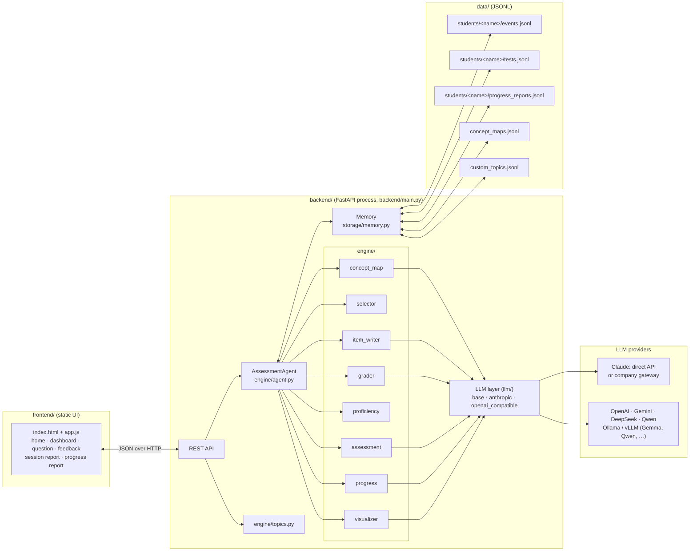
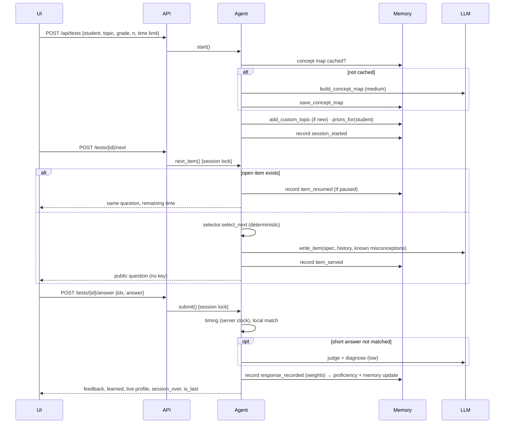
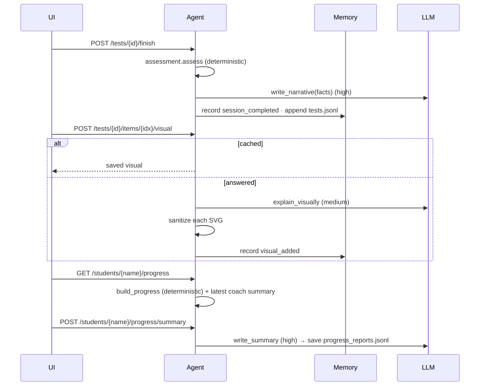

# Adaptive Math Assessment Agent: Design

| | |
|---|---|
| Document | Software design: how the system meets the [specification](SPECIFICATION.md) |
| Status | Reflects the implementation in this repository |
| Date | 2026-11-26 |

---

## 1. Design principles

1. **The LLM writes; code decides.** The LLM builds concept maps, writes problems, diagnoses
   wrong answers, draws diagrams, and writes explanations. *Which* concept to test, at *what*
   difficulty, and *how* mastery is scored is deterministic Python. That makes decisions
   explainable, testable, and identical across providers.
2. **Facts before narrative.** Report numbers are computed first; the LLM receives them as
   facts to explain and is constrained by schema (e.g. one note per concept the engine lists).
3. **Event-sourced memory.** Every state change is an appended JSONL event. State is a pure
   function of the log, so restarts, resumes, and audits come for free.
4. **Structured output everywhere.** Every LLM call requests a JSON Schema and the result is
   validated locally, whatever the provider promises.
5. **Untrusted model output.** Model text is rendered as text; model SVG is sanitized and
   displayed as an image; answer keys never leave the server before an answer.

---

## 2. Architecture



### 2.1 Components

The repository has two deployable parts: **`backend/`**, a Python package with the API
(`main.py`), the assessment engine (`engine/`), the LLM layer (`llm/`), storage
(`storage/`) and tests (`tests/`); and **`frontend/`**, static HTML/CSS/JS that talks to
the backend only through `/api/*`. The engine has no web dependencies; `main.py` is a thin
adapter around `AssessmentAgent`. Dependencies point inward: `main → engine → llm`, and
`engine ↔ storage` only through `Memory` and `ProficiencyModel`.

| Component | File | Responsibility |
|---|---|---|
| Web/API layer | `backend/main.py` | HTTP routes, request validation (Pydantic), error mapping, static files, start-up wiring |
| Orchestrator | `backend/engine/agent.py` | Session lifecycle (start, next, submit, pause, finish), visuals, history, progress; per-session locks; timing rules |
| Concept map | `backend/engine/concept_map.py` | LLM decomposition of topic + grade into concepts, prerequisites, and cross-area concepts; id normalization |
| Proficiency model | `backend/engine/proficiency.py` | Per-concept ability θ, update rule, mastery, confidence, credit/blame weights |
| Selector | `backend/engine/selector.py` | The adaptive policy: next concept, mode, difficulty, dimension, type, perspective, format, reason |
| Item writer | `backend/engine/item_writer.py` | LLM writes a problem to the selector's spec; validates multiple-choice structure; clamps the time limit |
| Grader | `backend/engine/grader.py` | Local equivalence matching; distractor diagnostics; LLM judge and diagnosis for short answers |
| Assessment | `backend/engine/assessment.py` | Deterministic concept-level session assessment plus the LLM narrative |
| Progress | `backend/engine/progress.py` | Deterministic cross-session progress report plus the LLM coach summary |
| Visualizer | `backend/engine/visualizer.py` | LLM pictorial explanations; SVG sanitizer |
| Memory | `backend/storage/memory.py` | JSONL persistence, event replay, sessions, cross-session student memory, priors, timers |
| Topics | `backend/engine/topics.py` | Predefined K–12 topic list with grade ranges |
| LLM layer | `backend/llm/` | Provider interface, JSON extraction and validation, retry; Anthropic and OpenAI-compatible adapters; provider selection |
| UI | `frontend/` | Single-page app in plain JavaScript, no build step |
| Launcher | `start.sh` | venv and dependencies, `.env` loading, direct/gateway connection selection, server start |

---

## 3. Data model

### 3.1 Storage layout

```
data/
  concept_maps.jsonl            one concept map per (topic, grade): shared
  custom_topics.jsonl           topics added beyond backend/engine/topics.py: shared
  students/<student-key>/
    student.json                {name, key, created_at}
    events.jsonl                event log: source of truth
    tests.jsonl                 one consolidated record per completed session
    progress_reports.jsonl      saved coach summaries
```

`student-key` = the name lowercased, with runs of non-alphanumerics replaced by `-`
(≤ 60 characters).

### 3.2 Events (`events.jsonl`)

Every event has `ts` (epoch seconds), `type`, `student_key`, and usually `session_id`.

| Type | Payload | Effect on replay |
|---|---|---|
| `session_started` | `student_name, topic, grade, num_questions, time_limit_minutes, concept_map_key, llm, prior{concept→{theta,evidence}}, prior_overall` | Creates the session, with a `ProficiencyModel` seeded from the priors |
| `item_served` | `idx, spec, item` | Appends the item; its timer starts (`active_since = ts`) |
| `attempt_recorded` | `idx, attempt{answer, is_correct, misconception, error_concept, note, time}` | Appends a wrong try (re-attempts left); no proficiency change yet |
| `item_paused` | `idx` | `elapsed += ts − active_since; active_since = None` |
| `item_resumed` | `idx` | `active_since = ts` |
| `response_recorded` | `idx, response{answer, is_correct, timed_out, time_taken, outcome, misconception, error_concept, note, weights, attempts[], attempt_count}` | Applies the proficiency update **once per problem** with the stored weights; records the misconception of **every** wrong attempt; snapshots proficiency; updates student memory |
| `visual_added` | `idx, visual` | Attaches the pictorial explanation |
| `session_completed` | `assessment, narrative` | Marks the session completed |

Credit weights are stored in the event, not recomputed, so replay stays exact even if
weighting rules change later.

### 3.3 Core objects

**Selector spec** (stored in `item_served.spec`):

```json
{
  "mode": "probe", "rationale": "Missed 'Equivalent fractions' last time, so re-testing…",
  "primary": {"id": "equivalent-fractions", "name": "…", "area": "Number & Operations", "description": "…"},
  "secondary": [{"id": "area-of-rectangles", "...": "..."}],
  "difficulty": 3, "dimension": "direct_concept", "question_type": "word",
  "perspective": "error_analysis", "answer_format": "multiple_choice", "theta_before": 3.9
}
```

**Item** (`item_served.item`; never sent to the browser before answering):
`question_text, choices[], choice_diagnostics[{misconception, concept_id}], correct_answer,
accepted_answers[], answer_hint, solution_steps[], concepts[{name, area, role}],
time_limit_seconds, answer_format`.

**Concept map**: `key, topic, grade, summary, created_at, llm,
concepts[{id, name, area, description, prerequisites[ids], external}]`.

**Student memory** (in memory, rebuilt from events): `concepts{id → ConceptEstimate}`,
`concept_info{id → name, area, topics, last_seen}`,
`misconceptions[{session_id, concept_id, misconception, ts}]`, `sessions[ids]`.

### 3.3a Deleting a session
The log is append-only *except* for deletion, which must really remove data.
`Memory.delete_session` (under the global write lock and the session's lock) rewrites the
student's `events.jsonl` and `tests.jsonl` without that session's lines, via
`JsonlFile.rewrite`: write `*.tmp`, `fsync`, `os.replace`, so a crash leaves either the old
or the new file. It then drops all the student's in-memory sessions and memory and replays
their remaining events (`_load_student`), so cross-session estimates, misconceptions,
progress and future priors carry no trace of the deleted session. `student.json` keeps the
student listed with 0 sessions. `progress_reports.jsonl` isn't rewritten; its
`evidence_count` no longer matches, so the coach summary shows as stale. An event that
arrives for a deleted session (e.g. a picture finishing generation) is discarded by
`Memory.record`.

### 3.4 `tests.jsonl` record
Self-contained: student, topic, grade, LLM, timestamps, `num_questions`,
`time_limit_minutes`, `session_time_used`, priors, every answered item (`spec, item,
response, proficiency_after, visual`), `final_proficiency`, `assessment`, `narrative`.

---

## 4. Algorithms

### 4.1 Proficiency model (`backend/engine/proficiency.py`)

An Elo / one-parameter-IRT style estimator on the difficulty scale.

```
p(correct)  = 1 / (1 + e^-(θ − d))
K           = max(0.6, 2.4 / (1 + 0.5 · evidence))
θ          ← clamp(θ + K · w · (outcome − p), 0.5, 10.5)
evidence   += w
```

| Input | Values |
|---|---|
| `outcome` | 1.0 correct on the first try and in time · 0.5 correct only after a re-attempt, or over time · 0.0 wrong |
| `w` (weight) | Success: primary 1.0, each secondary 0.5. Miss with the grader naming a concept: that concept 1.0, others 0.25. Miss otherwise: primary 1.0, secondary 0.5 |

- **Untested concepts** borrow the student's overall ability:
  `θ_eff = (θ_prior·evidence + θ_overall) / (evidence + 1)`. The selector further caps it at
  *(lowest tested ancestor θ) + 1*.
- **Mastery**: `secure` if θ ≥ 6; `gap` if θ < 4 **and** at least one miss; `not_assessed`
  if no attempts; otherwise `developing`.
- **Confidence**: evidence < 1.5 → low; < 3.5 → medium; else high.
- **Overall ability**: a separate estimate updated with weight 1 on every item.
- **Level description**: θ < 2.5 below grade · < 4.5 approaching · < 6.5 at grade ·
  < 8.5 above · otherwise well above.

### 4.2 Priors from memory (`Memory.priors_for`)
For each concept in the new map that the student has history on:
`prior θ = remembered θ`, `prior evidence = min(evidence, 2) × 0.5`. Ability carries over,
but the new session re-verifies it. The overall prior is the mean of those θs (or the mean
over all remembered concepts, or 4.0 for a new student).

### 4.3 Selection policy (`backend/engine/selector.py`)

Every core (non-external) concept is scored; the highest score becomes the primary concept.

| Condition (first match) | Mode | Score |
|---|---|---|
| Untested, and a prerequisite of a *suspected* concept | `root_cause` | 4.0 |
| Untested | `explore` | 3.0 − 0.15·(position in map), +0.8 if it was a gap in memory |
| Last outcome < 1 and attempts < 2 | `probe` | 2.6 |
| Gap with low confidence | `probe` | 2.2 |
| Confirmed gap | `probe` (revisit) | 0.7 |
| Secure | `stretch` | 1.2 (0.6 after 3 attempts) |
| Otherwise | `confirm` | 1.8 − 0.2·attempts |

Adjustments: same concept as the last item −2.0 (only −0.5 for a probe); any ancestor
suspected and mode is explore/confirm/stretch −1.5; uncertainty bonus +0.3/(1 + evidence).
*Suspected* = attempted and (θ < 4 or last outcome < 1).

Then, for the chosen concept with effective θ:

| Decision | Rule |
|---|---|
| Difficulty | probe: min(θ, last difficulty on this concept) − 1 · root cause: θ − 0.5 · stretch: θ + 1.5 · otherwise θ (rounded, clamped 1–10) |
| Dimension | probe/root cause → direct · stretch, or confirm with θ ≥ 4.5 → multi · no multi-concept item in the last 3 and θ ≥ 4 (after 2 items) → multi · else direct |
| Secondary concept | Prefer cross-area (external) concepts or core concepts from a different strand, least used so far |
| Perspective | probe/root cause: least used of {error analysis, conceptual, representation}; else least used for this concept, then overall |
| Word vs direct | Keep balanced; application/estimation lean to word |
| Answer format | Multiple choice if probing or fewer than ⅓ multiple choice so far; else short answer |

Behavior verified with simulated students (see §9): strong students climb from 4 to 10
with stretch items; a gap only in a dependent concept is isolated; a gap rooted in a
prerequisite is confirmed, and dependents are deferred until later.

### 4.4 Grading (`backend/engine/grader.py`)
1. Blank → wrong.
2. Multiple choice → compare letters; on a miss, the chosen option's `choice_diagnostics`
   give the misconception and implicated concept (no LLM call).
3. Short answer → normalize (case, spaces, Unicode operators, `$`, a leading `x=`), then
   compare exactly or numerically (fractions, decimals, percents, thousands separators,
   tolerance 1e-9) against the key and accepted answers.
4. Otherwise → LLM judge (effort *low*) returns `{is_correct, misconception, error_concept ∈
   tagged concepts, note}`.

### 4.4a Re-attempts (`backend/engine/agent.py`)
A session has `reattempts` ∈ 0–3, so attempts allowed = 1 + reattempts. On submit, after
grading: if the answer is wrong, non-blank, not timed out, the session isn't over, and
attempt < allowed, the agent records `attempt_recorded` and returns
`{retry, attempts_left, note, hint = misconception, question}`, with no key or solution. The
item's clock keeps running. Otherwise it records the final `response_recorded` with all
attempts; outcome = `outcome_value(correct, timed_out, attempt)`; blame weights use the last
wrong attempt's implicated concept. The grader and item-writer prompts forbid notes and
misconceptions from revealing the answer, since they can now be shown before it. The public
question carries `attempts_allowed`, `attempts_used` and `previous_answers`, so a resumed
session restores the state (tried options disabled, last short answer prefilled). The
session assessment adds `attempts{reattempts_allowed, first_try_correct, correct_after_retry}`.

### 4.4b Timer modes and pause
A session has `timer_mode` ∈ {`auto`, `fixed`, `off`} and `seconds_per_question` (only for
`fixed`). After the item writer returns, the agent stores the AI's limit as
`suggested_time_limit_seconds` and sets `time_limit_seconds` to the fixed value, or to `None`
when untimed. Every consumer treats `None` as "no limit": the public question has
`remaining_seconds: null`, `timed_out` is always false, assessment timing reports `untimed`
and computes `avg_fraction_of_limit` over timed items only, the progress report skips
untimed items in timing ratios, and the narrative prints "(untimed)". `off` forces
`time_limit_minutes = None` (the API rejects the combination). **Pause** reuses
`POST /pause` (`item_paused`). The UI hides the problem until **Resume**, which calls `/next`
and gets the same item back via `item_resumed`, with the remaining time.

### 4.4c Sessions from the user's own question (`backend/engine/question_analyzer.py`)
1. **Analyze** (`POST /api/questions/analyze`): the upload is validated (≤ 10 MB; images and
   PDF go to the model as attachments, `.txt` is decoded into the prompt). One structured call
   returns the transcription, topic, suggested grade, 4–8 concepts with prerequisites and an
   `in_question` flag, connected areas, the **structure** (problem type, answer format, steps,
   representation, context, pattern, strategy), difficulty, answer and solution. User
   problems raise `UploadError` → 422; it's deliberately not a `ValueError`, which the agent
   maps to "unusable model output" (502).
2. **Confirm**: the UI shows the analysis. Edits to the text or file, or a grade change,
   invalidate it.
3. **Start** (`POST /api/tests` with `seed`): the server re-validates the analysis against the
   schema and builds the concept map from it (`normalize_concept_map`, key
   `seed-<sha1(grade|text)>`, no extra call). The session stores a **seed summary**
   (question text, structure, difficulty, primary and in-question concept ids, answer,
   source kind and file name; never the file).
4. **Adapt**: item 1 is `mode = mirror` (primary concept + one in-question concept, the seed's
   difficulty, type and format). Later items use the normal policy with +0.4 for in-question
   concepts, the seed's problem type, and multiple choice when the seed was multiple choice.
   The item writer gets a MODEL QUESTION block (mirror the structure with new numbers and
   context; a close parallel for the opening item). The narrative relates findings to the
   question.

The LLM layer accepts `attachments` (`[{media_type, data}]`): Anthropic sends
`image`/`document` blocks before the text, and OpenAI-compatible providers send `image_url`
data URIs (PDF → a clear error).

### 4.5 Timing (`backend/storage/memory.py`, `backend/engine/agent.py`)
- Item time used = `elapsed + (now − active_since if running)`.
- Session time used = Σ over items (`time_taken` if answered, else live time used).
- Remaining for a problem = min(item limit − used, session limit − session used).
- `timed_out` if used > item limit + 3 s grace; `time_taken` is then capped at the limit.
- The session is over when session time left ≤ 3 s; `/next` then returns
  `{done, ended_by_time}`; the report's timing records `ended_by_time` if fewer than the
  planned questions were answered.
- The browser pauses the item on navigation (`POST /pause`) and on `pagehide`
  (`navigator.sendBeacon`).

### 4.6 Session assessment (`backend/engine/assessment.py`)
Deterministic: per-concept table (θ, mastery, confidence, correct/attempts, questions,
misconceptions); **root causes** = a gap or developing concept whose prerequisite is a gap;
**unchecked prerequisites**; accuracy by dimension, type, perspective; timing; difficulty
path; overall θ and level. The LLM narrative (effort *high*) must return one
`concept_notes` entry per concept id the engine listed (an enum in the schema), plus
per-question analysis, strengths, areas to improve, misconception and timing insights, and
next steps.

### 4.7 Progress report (`backend/engine/progress.py`)
Deterministic, across all of a student's sessions:
- **Ability trend**: overall θ at the end of each completed session.
- **Concept growth**: last minus first per-session θ for concepts tested in ≥ 2 sessions.
- **Strand averages**, **topic table** (first → latest ability, latest gaps), accuracy by
  kind, timing.
- **Misconception status**: *likely resolved* if the concept was answered correctly after
  the last sighting **and** is now secure; *improving* if only the first holds; otherwise
  *still present*.

The coach summary (LLM, effort *high*) is stored with `evidence_count` (answered items).
It's flagged stale when the current count differs.

### 4.8 Pictorial explanations (`backend/engine/visualizer.py`)
The prompt gives the problem, key, worked solution, the student's answer, and the
misconception, with drawing rules: a 480×260 viewBox, basic shapes only, drawn to scale,
numbers matching the solution, direct labels, a fixed palette with color never the only
cue, and 2–4 panels building set-up → key step → result, plus a "why your answer can't be
right" panel after a miss. Output: `{intro, panels[{title, svg, caption, alt}], key_idea}`.
Each panel's SVG goes through the sanitizer (§7); invalid panels are dropped, and if none
survive the call fails.

---

## 5. Request flows

### 5.1 Start → next → submit



### 5.2 Finish, visual, progress



### 5.3 Concurrency
A single asyncio process. Per-key `asyncio.Lock`s: `session_id` (next, submit, pause,
finish), `map:<key>` (one concept-map build per topic and grade), `visual:<sid>:<idx>`,
and `progress:<student>`. One global write lock serializes JSONL appends. Opening the same
question twice (refresh, double-click) returns the open item rather than generating a new
one.

---

## 6. LLM layer (`backend/llm/`)

### 6.1 Interface
`LLMProvider.generate_json(system, prompt, schema, effort, max_tokens) -> dict`:
1. The adapter returns raw text (`_complete_json`).
2. `extract_json` strips `<think>…</think>` and code fences and takes the outermost `{…}`.
3. `validate` checks types, required keys, enums, and nesting (a minimal JSON Schema subset).
4. On failure, it retries once with the validation error appended; then raises `LLMError`,
   which becomes HTTP 502 with a readable message.

### 6.2 Adapters

| Adapter | Used for | JSON enforcement | Notes |
|---|---|---|---|
| `AnthropicProvider` | Claude (default `claude-opus-5-5`) | `output_config.format` JSON schema + `effort` | Streaming with `get_final_message()`. Server-side refusal fallback (`fallbacks="default"`, beta `server-side-fallback-2026-07-01`) for supported models; on HTTP 400 it retries once without it and remembers. Handles `refusal` and `max_tokens` stop reasons |
| `OpenAICompatibleProvider` | OpenAI, Gemini, DeepSeek, Qwen, Ollama, vLLM, others | `response_format` `json_schema` (strict) or `json_object` with the schema in the prompt | `max_tokens` vs `max_completion_tokens` per preset; output capped at 16k tokens; handles `length` finish and refusals |

### 6.3 Claude connection modes

| Mode | Configuration | Mechanism |
|---|---|---|
| Direct | `ANTHROPIC_API_KEY` | SDK default credentials; `start.sh direct` **unsets** `ANTHROPIC_BASE_URL` and the helper |
| Gateway | `GATEWAY_BASE_URL` + `GATEWAY_TOKEN_HELPER` (or `ANTHROPIC_BASE_URL` + `ANTHROPIC_API_KEY_HELPER`) | The helper command is run (in a thread, 60 s timeout); the token is sent as `x-api-key` and `Authorization: Bearer`; refreshed every `ANTHROPIC_API_KEY_HELPER_TTL` s (default 300) and after an authentication error |

`describe()` reports `{provider, model, connection}`, e.g. `gateway (host)` or `direct API`.
It's stored on every session and shown in the UI.

### 6.4 Calls per session

| Call | Effort | max_tokens | When |
|---|---|---|---|
| Concept map | medium | 16k | Once per (topic, grade), then cached |
| Item writer | medium | 16k | Every item |
| Judge | low | 4k | Short answers that don't match locally |
| Session narrative | high | 64k | Finish |
| Coach summary | high | 32k | On request |
| Pictorial explanation | medium | 32k | On request, once per item |

Measured on Claude Opus 5.5 through the gateway: concept map 17 s; items 8–18 s; judge
~3 s; narrative 50 s; coach summary 27 s; picture 69 s; a 5-item session end to end 163 s.

---

## 7. Security design

| Threat | Control |
|---|---|
| Answer leakage | Public question payloads are built from an allow-list (`_public`); keys and diagnostics are returned only after `submit`; pictures are refused before answering (409) |
| XSS from model text | The UI builds DOM nodes and inserts model text with `textContent`, never `innerHTML` |
| Malicious SVG | `sanitize_svg`: rejects DOCTYPE/ENTITY (entity expansion), non-`<svg>` roots, invalid XML, and > 60k characters. Allow-listed elements only (no `script`, `style`, `foreignObject`, `image`, `a`). Allow-listed attributes only (no `on*`). `href` must be `#internal`; `url(…)` must be `#internal`. Width/height removed, viewBox enforced. Rendered as an ``, where SVG can't run scripts or fetch resources |
| Credential misrouting | `start.sh direct` clears the gateway URL and helper; gateway tokens are kept only in process memory and never logged |
| Secrets on disk | `.env` is read only by `start.sh`; `.gitignore` excludes `.env`, `.venv/`, `data/` |
| Timer manipulation | The server clock is authoritative; the client countdown is display only |
| Path traversal via names | Student folders use the sanitized key (`[a-z0-9-]`) |
| Network exposure | The server binds to `127.0.0.1` by default; no authentication, by design (trusted local machine) |

---

## 8. Front end (`frontend/`)

Plain JavaScript with no framework or build step. The `el()` and `svg()` helpers create
nodes safely.

| Screen | Contents |
|---|---|
| Home | Student name form; saved students (completed / to-continue counts, last active); model and connection footer |
| Dashboard | Continue list (progress bar, session time left); new-session form (grade → topic picker with strands, "Your topics", "Add a new topic…", show all grades; question count; session time incl. custom; plan summary); completed sessions; progress report button |
| Question | "Problem n of N · k answered" with one dot per question (filled = answered, ringed = current), session clock (amber < 2 min, red < 30 s), item timer ring (amber ≤ 30%, red ≤ 10%), tags (focus, type, dimension, perspective), difficulty as a text label ("level 4/10 · on grade level (routine)"; deliberately not a segmented bar, which was mistaken for progress), choices or short answer, Save & exit |
| Feedback | Result banner, answer vs key, time, note, misconception, session time, solution, concepts, **Explain with a picture**; side panel: why this problem, what the agent learned, live concept map |
| Session report | Stats (incl. session time), difficulty path, summary, root causes, concept cards, accuracy by kind, misconceptions and timing, question-by-question (with pictures), strengths / improve / next steps |
| All questions & explanations | Filters (session, topic, result, search), expand/collapse all; one card per answered question grouped by session (same card component as the session report, `questionCard`), with Session report / Continue per session. Data: `GET /api/students/{name}/questions` → `AssessmentAgent.question_history`, built from `answered_questions(s)`, which includes only items with a final response |
| Progress report | Stats; ability-over-time line chart (single series, grade reference line, crosshair and tooltip, keyboard arrows, table view; x labels switch to `#n` when dates collide); coach summary; mastery by strand with growth; strengths and focus; misconceptions over time; topics table; accuracy by kind; timing habits |

---

## 9. Testing

| Layer | How | Where |
|---|---|---|
| LLM layer | JSON extraction (`<think>`, fences), schema validation, retry on invalid output, provider presets, key helper (caching, failure), fallback-beta retry | `backend/tests/test_offline.py` |
| Proficiency and selector | Update direction, weights, mastery rules; simulated students: all-correct, gap in a dependent concept, gap rooted in a prerequisite | `backend/tests/test_offline.py` and traces |
| End to end (stub LLM) | Full session over HTTP; no key leakage; refresh-safe `next`; 409 on double answer; reports; progress; per-student files; pause and resume; multiple students; replay equality | `test_end_to_end` |
| Topics and timing | Grade filtering, custom topic persistence and dedupe, session clock cap, expiry → `ended_by_time` | `test_topics_and_session_time_limit` |
| Security | SVG sanitizer against scripts, handlers, external refs, entities, malformed XML; visual endpoint gating and caching | `test_svg_sanitizer` |
| Launcher | Direct/gateway/auto selection, inherited gateway URL cleared, missing config, bad mode | `start.sh` with `PYTHON=false` |
| UI | JavaScript parsed with JavaScriptCore; DOM id cross-check; API field cross-check; headless-Chrome screenshots (dashboard, progress, form, question) | manual / scripted |
| Live | One 5-item session and one picture explanation on Claude Opus 5.5 through the company gateway | manual run |

Run `python3 -m backend.tests.test_offline` from the project root (no network or key needed).

---

## 10. Configuration reference

| Variable | Default | Purpose |
|---|---|---|
| `LLM_PROVIDER` | `anthropic` | `anthropic`, `openai`, `gemini`, `deepseek`, `qwen`, `ollama`, `vllm`, `openai_compatible` |
| `LLM_MODEL` | `claude-opus-5-5` (Anthropic) | Model id (required for other providers) |
| `ANTHROPIC_API_KEY` | none | Direct Claude access |
| `GATEWAY_BASE_URL` / `ANTHROPIC_BASE_URL` | none | Gateway endpoint |
| `GATEWAY_TOKEN_HELPER` / `ANTHROPIC_API_KEY_HELPER` | none | Command that prints a gateway token |
| `ANTHROPIC_API_KEY_HELPER_TTL` | `300` | Seconds between token refreshes |
| `LLM_BASE_URL`, `LLM_API_KEY`, `LLM_JSON_MODE` | none | Overrides for OpenAI-compatible providers |
| `DATA_DIR` | `./data` | Storage root |
| `PORT` | `8000` | Server port (`start.sh`) |

---

## 11. Design decisions

| Decision | Alternatives considered | Rationale |
|---|---|---|
| Deterministic selector + LLM item writer | LLM chooses the next question | Explainable reasons; testable; consistent across models; cheaper prompts |
| Elo/1-PL style θ per concept | Full IRT calibration; Bayesian knowledge tracing | No item bank to calibrate (items are generated); intuitive scale shared with difficulty; works from one response |
| Event-sourced JSONL per student | SQLite / database | Requested JSONL; human-readable; per-student portability; replay gives resume and audit |
| Delete = rewrite + replay | Tombstone event that hides the session | Deletion should really remove the data; replaying the remaining events guarantees memory and reports have no residue |
| Store credit weights in events | Recompute on replay | Replay stays exact if rules change |
| Session clock counts only on-screen time | Wall-clock session timer | Fair to students: generation latency and breaks don't consume their time |
| LLM-drawn SVG, sanitized, in `` | Fixed client-side diagram renderers | Covers any topic and diagram type; quality verified live; defense in depth against malicious markup |
| Server-side fallback with automatic downgrade | Always on / always off | Refusal safety on the direct API; still works through gateways that reject the beta |
| Single process, in-memory state | Distributed services | Local single-user tool; simplest correct design |

---

## 12. Extension points

- **New LLM provider**: subclass `llm.base.LLMProvider`, implement `_complete_json`, and
  register it in `backend/llm/__init__.py`.
- **Policy tuning**: thresholds in `backend/engine/proficiency.py` (`SECURE_THETA`, `GAP_THETA`,
  `K`) and scores in `backend/engine/selector.py`.
- **Topics**: edit `PREDEFINED` in `backend/engine/topics.py`.
- **Grade lock / standards tagging** (see spec §9): clamp difficulty in the selector, and/or
  add a `standard` field to the item schema with a post-generation check.
- **Hosting**: replace `Memory` with a database-backed implementation of the same
  interface, and add authentication in `backend/main.py`.
